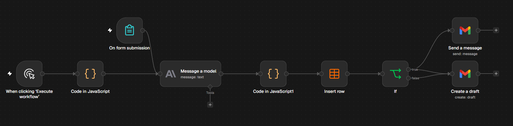
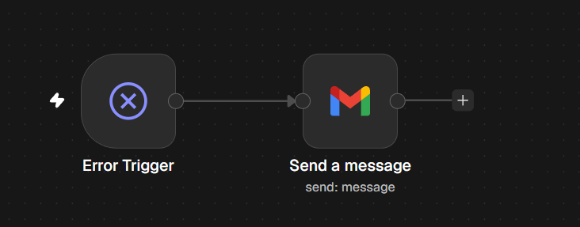
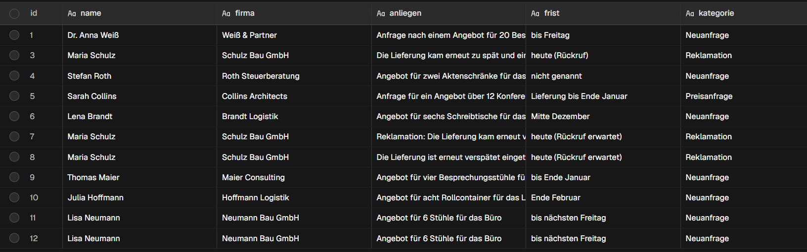
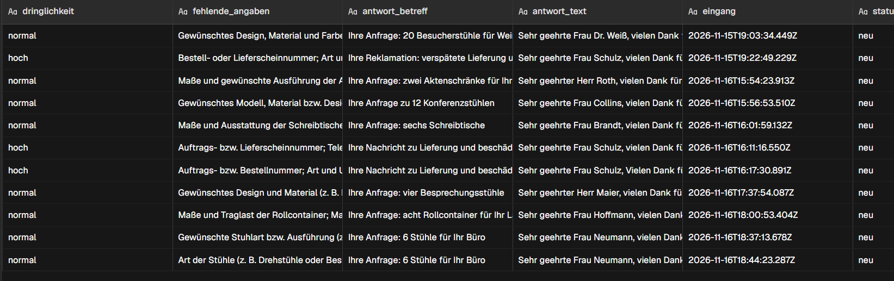

# KI-Automation-Lab: Postfach-Assistent (Prototyp)

Prototyp eines KI-Assistenten für Firmen-Postfächer, gebaut mit **n8n** und der **Claude API**.
Alle Daten sind **erfunden**. Es gibt keine Kunden und keinen Echtbetrieb. Das Projekt ist ein Lern- und Demoprojekt.

## Problem

In kleinen Firmen landen Kundenanfragen im Postfach. Jemand muss jede Mail lesen, einordnen, Dringendes erkennen und eine Antwort vorbereiten.

## Lösung

Der Workflow liest eine Anfrage, lässt Claude sie als strukturiertes JSON auswerten und legt einen Antwortentwurf an. Bei hoher Dringlichkeit gibt es eine Warnung. **Ein Mensch prüft jeden Entwurf und sendet selbst. Es gibt keinen Autoversand an Kunden.**

## Ablauf

1. Eingang über ein n8n-Formular (Text + E-Mail) oder einen manuellen Test mit 5 Beispieltexten
2. Claude analysiert die Anfrage und liefert JSON: Name, Firma, Anliegen, Frist, Kategorie, Dringlichkeit, fehlende Angaben, Antwortbetreff, Antworttext
3. Ein Code-Knoten liest das JSON ein; bei ungültiger Ausgabe wird ein Fehlerstatus gespeichert
4. Speicherung in einer n8n-Data-Table `anfragen`
5. If-Knoten: Dringlichkeit „hoch“ löst eine Warnmail an einen internen Empfänger aus
6. Gmail legt den Antwortentwurf als **Entwurf** an (wird nicht gesendet)
7. Separater Fehler-Workflow „Fehlermeldung“ schickt bei einem Workflow-Fehler eine Mail

Fehler-Workflow:

## Technik

- n8n (lokal, per `npx n8n`)
- Claude API (Modell `claude-sonnet-5-5`), Ausgabe als JSON per Prompt-Vorgabe
- n8n Data Table, Gmail (OAuth, Google-Cloud-Projekt im Testmodus)
- JavaScript in n8n-Code-Knoten

## Tests

Der manuelle Test enthält 5 erfundene Beispielanfragen (unklare Anfrage, Neuanfrage, Preisanfrage, Reklamation, vage Anfrage). Es gibt **noch keine systematische Auswertung** und keine Trefferquote.

Beispielausgabe der Data Table `anfragen` (erfundene Anfragen):

## Grenzen

- Prototyp, nicht im Produktivbetrieb, nur mit erfundenen Daten getestet
- Gmail im Testmodus (Anmeldung läuft nach ca. 7 Tagen ab)
- Mails werden nicht automatisch aus einem Postfach gelesen; der Eingang ist ein Formular
- Qualität bei echten Kundenmails ist nicht geprüft
- Datenschutz (Auftragsverarbeitung, Datenverarbeitung in den USA) ist für einen echten Einsatz noch zu klären

## Setup in 5 Schritten

1. n8n starten: `npx n8n`, dann `http://localhost:5678` öffnen
2. Beide Dateien aus `workflows/` über „Import“ in n8n laden
3. Eigene Zugangsdaten anlegen: Anthropic API und Gmail (OAuth). Die Platzhalter in den Knoten ersetzen
4. Eine Data Table `anfragen` mit den Spalten aus dem Knoten „Insert row“ anlegen und im Knoten auswählen
5. Im Knoten „Send a message“ die eigene Adresse eintragen und den Workflow testen

## Nächster Schritt (in Arbeit)

Auftragserfassung: Aus Kundenmails und PDF-Bestellungen sollen Auftragszeilen mit Abgleich gegen einen Artikelstamm entstehen, ausgewertet gegen Soll-Zeilen.

## Hinweis

Alle Namen, Firmen und Texte sind erfunden. Ähnlichkeiten mit realen Personen oder Firmen sind zufällig.
